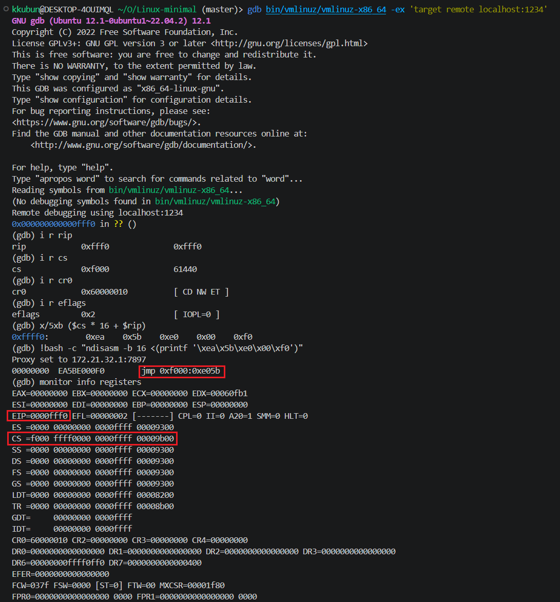
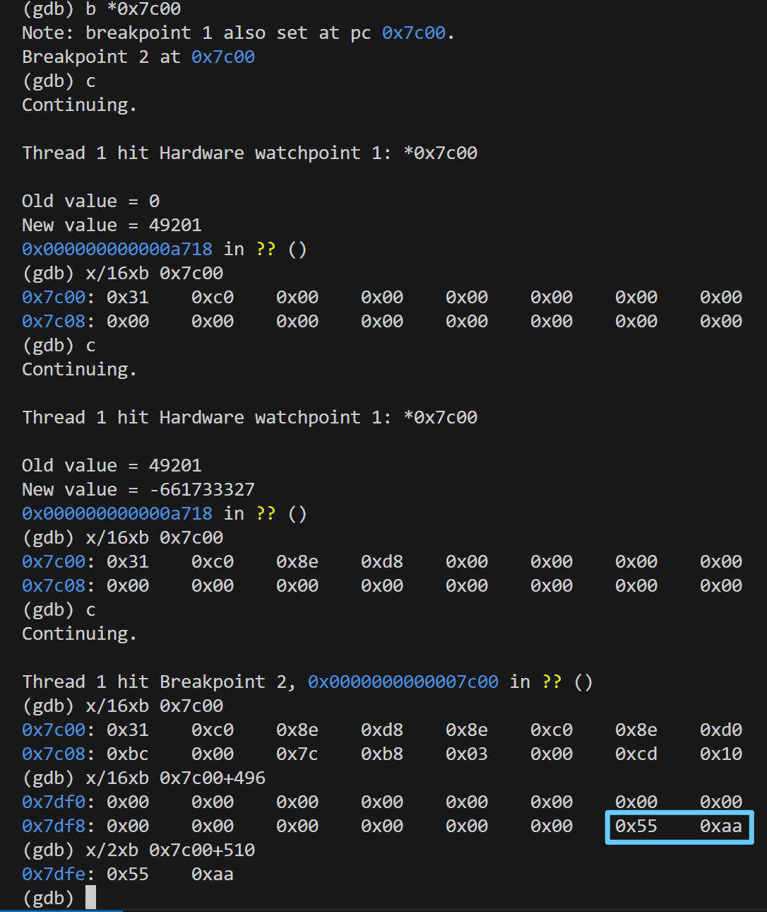

# CPU Reset → Firmware → Boot loader → start_kernel() →

```txt
# 综述：
t = 0ms        插电，电源开始工作
──────────────────────────────────────────────────────────────
t ≈ 100ms      电源各路电压稳定，发出 PWR_GOOD
        芯片组释放 CPU RESET# 信号
        CPU 瞬间完成复位（EIP=0xFFF0, CS=0xF000, CR0.PE=0等）
──────────────────────────────────────────────────────────────
t ≈ 100ms+     CPU 从 0xFFFFFFF0 取第一条指令
        （BIOS ROM 高位镜像，指令：ljmp $0xf000,$0xe05b）
        CS.base 变为 0xF0000，并跳转到 0xFE05B
──────────────────────────────────────────────────────────────
t ≈ 100ms~几s  BIOS POST 自检阶段
        ├─ 检测 CPU（读 CPUID，确认指令执行正常）
        ├─ 检测内存（数内存条、简单读写校验，耗时跟容量成正比）
        ├─ 初始化芯片组（北桥/南桥基本配置）
        ├─ 检测显卡（调用显卡 Option ROM，初始化显存）
        ├─ 检测键盘控制器、USB 控制器等
        └─ POST 完成，屏幕可能闪一下或显示厂商 Logo
──────────────────────────────────────────────────────────────
t ≈ 几百ms~几s BIOS 启动服务阶段
        ├─ 按 Boot Order 枚举设备
        ├─ 对每个设备：读第一个扇区（LBA 0 / CHS 0,0,1）
        ├─ 检查末尾两字节是否为 0x55AA
        ├─ 找到 → 通过 INT 0x13 将该扇区512B加载到 0x7c00
        └─ jmp 0x7c00，控制权交给 MBR
──────────────────────────────────────────────────────────────
t ≈ 几秒 MBR 执行
        ├─ MBR 代码（0x7c00 起，446字节）运行
        ├─ 扫描分区表（64字节），找到活动分区
        ├─ 读取活动分区的引导扇区（VBR）或 bootloader 第二阶段
        │   （比如 GRUB stage2 的 core.img，加载到某段内存）
        └─ jmp 到 bootloader 第二阶段
──────────────────────────────────────────────────────────────
t ≈ 几秒 Bootloader 第二阶段运行
        （GRUB2：core.img → 加载 normal.mod → 读 grub.cfg）
        ├─ 显示启动菜单（等待用户选择，可超时跳过）
        ├─ 用户选择后：加载内核镜像到内存
        │   （bzImage → 解压代码 + 压缩内核体分别就位）
        ├─ 加载 initrd/initramfs 到内存
        ├─ 填充 struct boot_params（内核启动参数）
        │   包括：内存布局、命令行参数、initrd 位置等
        ├─ 切换到保护模式（设置 CR0.PE=1）
        │   （GRUB 自身在保护模式下运行）
        └─ 跳转到内核入口（bzImage 的实模式入口 0x0000:0x0200
            或保护模式入口，取决于内核头 loadflags）
──────────────────────────────────────────────────────────────
t ≈ 几秒 Linux 内核接管（arch/x86/boot/header.S）
        ├─ 实模式/保护模式切换准备
        ├─ 解压内核（如果 bzImage 是压缩的）
        │   （解压到 0x100000 以上，即 1MB 以上物理地址）
        ├─ 切换到长模式（64位，设置 CR4.PAE, EFER.LME, CR0.PG）
        ├─ 跳转到 arch/x86/kernel/head_64.S
        ├─ 建立初始页表、设置 GDT/IDT
        └─ 调用 x86_64_start_kernel()
──────────────────────────────────────────────────────────────
t ≈ 几秒~十几秒 start_kernel()（init/main.c）
        ├─ 设置栈、初始化锁
        ├─ 解析 boot_params
        ├─ 初始化内存管理（memblock → buddy, slab）
        ├─ 初始化中断（IRQ、IDT）
        ├─ 初始化时钟/定时器
        ├─ 初始化进程调度器
        ├─ 初始化各种子系统（VFS、网络、IPC...）
        ├─ 启动 idle 进程（PID 0）
        ├─ 启动 kernel_init 线程（PID 1 的前身）
        │   ├─ 尝试运行 /sbin/init → /etc/init → /bin/init → /bin/sh
        │   └─ init 进程接管，启动用户空间服务
        └─ 内核进入后台，成为"中断/异常处理程序"
```


## 1. CPU RESET
- 为了让计算机能运行我们的程序，一定会存在一些软件/硬件的约定，使 CPU Reset 后，处理器处于某个确定的状态：
  - 当 CPU 接收到复位信号(如电源接通或硬件复位)时，它首先会**复位**（所有通用寄存器变为硬件复位值、EIP = 0xFFF0、CS初始化 如 CS.selector=0xf000 CS.base=0xFFFF0000 CS.limit=0x0000FFFF CS.access=00009b00、CR0=0x60000010、EFLAGS=0x2等），CR0复位标识着进入`实模式`，PC 指针一般指向一段 memory-mapped ROM（对于 x86 CPU，这个地址通常是 `0xFFFF0` (在 1MB 内存空间的​​最顶端，是一个 jmp 指令) (储存了厂商的firmware 即 BIOS/UEFI 的入口点)
  - `实模式`(Real Mode)(16位模式)：其真实的物理地址(20位)=段寄存器*16+偏移地址，可通过 `(gdb)x/i ($cs * 16 + $rip)` 查看具体要执行的指令。
  - Q: "0xFFFF0里的数据是怎么来的？"
    - A: `内存映射`(Memory-Mapped I/O，MMIO) 加电初始化时，芯片组会将 BIOS ROM 硬件通过内存映射I/O映射到20位总线模式下的高端地址(0xFFFFF-0xF0000 共64KB大小)，CPU 读取这些地址时实际上是从 BIOS ROM 中读取的数据。
  - Q: "CPU物理地址空间大小是2^N根地址线​​ 字节，为什么此时看到的是只有20位的物理地址空间(1MB)" 
    - A: 这是由硬件设计的历史兼容性和启动流程决定的
      1. 首先你可以通过 `cat /proc/cpuinfo | grep address | head -1` 查看到你的CPU​​地址总线宽度，现代CPU通常大于20。但是​加电复位时CPU会强制进入8086兼容状态(如：实模式+地址回绕)，从而兼容BIOS的设计模式。
      2. 大部分地址(低端区域0x00000–0x9FFFF)被映射到DRAM（内存条）​​：这是物理地址空间的主体。操作系统和应用程序的数据都存放在这里。
      3. 一部分地址(高端区域0xA0000–0xFFFFF)被映射到硬件设备（MMIO）​​：如 0xA0000-0xBFFFF映射到显卡显存，0xF0000-0xFFFFF映射到BIOS ROM。​​CPU访问这些地址时，​​数据来自设备而非DRAM​​，由`芯片组直接路由`。

```sh
> dmesg | grep e820  #　BIOS 报告的物理内存布局表
[    0.000000] BIOS-provided physical RAM map:
[    0.000000] [mem 0x0000000000000000-0x000000000009fbff] usable  # ​​常规低端640KB DRAM
[    0.000000] BIOS-e820: [mem 0x000000000009fc00-0x000000000009ffff] reserved  # 扩展 BIOS 数据区(EBDA, Extended BIOS Data Area)
[    0.000000] BIOS-e820: [mem 0x00000000000f0000-0x00000000000fffff] reserved  # BIOS ROM
[    0.000000] BIOS-e820: [mem 0x0000000000100000-0x000000000ffdffff] usable  # 解压后的Linux 内核主体
[    0.000000] BIOS-e820: [mem 0x000000000ffe0000-0x000000000fffffff] reserved  # 保留区域
[    0.000000] BIOS-e820: [mem 0x00000000fffc0000-0x00000000ffffffff] reserved  # ​​PCI 设备映射
[    0.006910] e820: update [mem 0x00000000-0x00000fff] usable ==> reserved  # 实模式数据IVT&BDA
[    0.007095] e820: remove [mem 0x000a0000-0x000fffff] usable  # MMIO
[    0.747347] e820: reserve RAM buffer [mem 0x0009fc00-0x0009ffff]  # 将 EBDA 区域标记为保留缓冲区
[    0.747500] e820: reserve RAM buffer [mem 0x0ffe0000-0x0fffffff]  # 高端内存的一些缓冲区
```
- 此时，CPU的 `CR0` 寄存器处于实模式状态，大部分特性处于关闭状态（如：缓存、虚拟存储、内存保护、分页机制等），所有内存访问都是对物理地址的直接读写。软件拥有对整个 1MB 地址空间（0x00000 - 0xFFFFF）的完全控制权。

```sh
qemu-system-x86_64 -kernel ./vmlinuz -append "console=ttyS0 nokaslr" -nographic -s -S 
# 然后和 gdb 调试：
gdb ./vmlinuz -ex 'target remote localhost:1234'
```

- `CS` Code Segment 代码段寄存器 (P.S. QEMU 打印的是已经展开好的“生效值”，不是原始字节)
  - 可见选择子 selector：0xF000, 16位
  - 隐藏 base：ffff0000, CPU Reset 硬编码的隐藏基地址寄存器
  - 隐藏 limit：0000ffff = 64KB
  - 原始 flags：00009b00, Access Rights：16位、非长模式；已访问、可读、可执行、位于代码段、DPL Ring0、存在于内存
  - 等等
- `CR0` ​(Control Registers)控制寄存器：
  - ​​PE (Protection Enable, 位 0)  = 0​​：​​禁用保护模式​。（这是 CPU 处于实模式的根本原因）
  - ET (Extension Type​​，   位 4)  = 1；兼容浮点协处理器格式。（x86 CPU上通常被硬编码为 1）
  - NW (Not Write-through​​，位 29) = 1；禁用了“通写”缓存策略。
  - CD (CaChe Disable，    位 30) = 1；禁用 CPU 内部缓存​。
  - PG (Paging Enable,     位 31) = 0​​：​​禁用分页机制​​。所有地址都是物理地址。
- `EFLAGS` (Extended Flags Register)算术状态标志和控制标志：
  - IOPL (I/O Privilege Level，位12和13) IOPL 的值是一个介于 0 到 3 之间的数字，代表​​环等级(Ring Level)。​​Ring 0​​: 最高特权级，也称为内核态或超级visor模式，可以执行任何指令，访问任何硬件资源；​​Ring 3：最低特权级​​，用户态
  - IOPL=0 的含义是：只有当前特权级(CPL, Current Privilege Level)为 0 的程序(即内核代码)才被允许执行与 I/O 相关的指令(IN,OUT,INS,OUTS,CLI,STI)，将操作硬件的权限完全保留给OS内核。如果 CPL > IOPL，那么任何尝试执行 I/O 指令的行为都会导致一个​​通用保护故障(#GP, General Protection Fault)，导致程序被操作系统终止
  - IF (Interrupt Enable Flag，位9) IF=0 中断关闭。（通过 CLI(Clear Interrupt) STI(Set Interrupt)指令调整）

### P.S. GDT 每个逻辑CPU的全局描述符表
  - `GDT`(Global Descriptor Table，全局描述符表)：Linux 的 `DEFINE_PER_CPU` 宏会在内核启动时（所以 CPU RESET时没有GDT）开一页 `gdt_page`，按 逻辑CPU数 拷贝 N 份 GDT，每个逻辑CPU都有自己的 GDTR (全局描述符表寄存器)，GDTR 寄存器指向 GDT （如 逻辑CPU i，它的 GDTR.base 指向 gdt_page[i] 的物理地址，这就是 逻辑CPU i 的 GDT，里面有多个 8字节的段描述符）
    - 一份 GDT 里通常只填十几个表项(段描述符)，Null、内核代码段、内核数据段、用户32位代码段、用户数据段、用户64位代码段、TSS任务状态段占2个槽位、LDT局部描述符表占2个槽位、TLS线程局部存储占3个槽位、CPUNODE per-CPU私有数据等等
    - 在保护模式下，GDT 是 CPU 实现**内存保护**与**特权隔离**的核心数据结构：它存储在内存中，每个表项（描述符）定义了一段内存的基址、大小和权限。
    - 当程序通过**段寄存器**加载选择子时，CPU 会索引 GDT 读取对应的**段描述符**，并将其中的基址、大小和权限“缓存”到段寄存器的`隐藏描述符`中。此后所有指令的地址计算和权限检查都直接依赖这份缓存，不再重复查表，减少内存访问开销。
    - 这样一来，GDT 既取代了实模式"段寄存器*16:offset"的简单寻址，让段可以位于 4GB 空间内的任意位置，又通过硬件强制的界限检查（offset越界触发 \#GP）和特权级验证（如阻止用户态ring3 访问 内核段ring0）实现了内存隔离与多任务安全，是保护模式能够区分内核/用户、防止非法访问的物理基础。

## 2. Firmware （BIOS/UEFI） 将用户数据加载到内存
- BIOS (basic I/O system)(基本输入输出系统): 固件，负责硬件检测、硬件初始化、上电自检(POST, Power-On Self-Test)，然后寻找可启动设备（如硬盘、光盘、USB、网络等）（“可启动”的判断标准是：第一个扇区最后两个字节是否为 “魔数” 0x55 和 0xAA）
1. CPU 从 物理地址 0xFFFFFFF0 继续执行，**jmp** 到​​BIOS固件代码​的初始化代码区 0xFE05B（jmp 0xf000:0xe05b： CS=0xf000 EIP=0xe05b）​，接着BIOS代码一路执行。
2. BIOS POST 通过后，按 Boot Order 枚举寻找可启动设备。找到后通过 磁盘I/O中断 INT 0x13 将该扇区512B加载到 0x7c00 DRAM 处（下图中 watchpoint 触发）
3. jmp 0x7c00，控制权交给 Bootloader。


- Q: "为什么BIOS要把主引导扇区数据载入内存0x7c00，而不是选择像 CPU Reset 一样直接做内存映射I/O？" 
  - A: 磁盘存储的数据量很大（通常以扇区为单位），而且磁盘访问速度较慢，因此磁盘内容通常不直接映射到内存地址空间供CPU执行，而是加载到内存供CPU读取。

- UEFI: TODO

## 3. ​​Bootloader​​
- MBR 是 Bootloader 的第一阶段。但由于 MBR 只有512字节，无法容纳大量复杂的逻辑，所以它通常只负责分区扫描(64Bytes分区表)、磁盘读取(通过BIOS磁盘中断(INT 13h)，​加载并跳转Bootloader第二阶段，即磁盘的其他扇区)和错误处理。
  - Bootloader 仍在实模式下运行，MBR后续扇区或其加载出来的GRUB可能会完成一些基本设置（如文件系统解析​、多系统引导、硬件检测与初始化​​​等）。
- 最后加载内核到内存，传递好启动参数 [struct boot_params](https://code.dragonos.org.cn/xref/linux-6.6.21/arch/x86/include/uapi/asm/bootparam.h#185)，将CPU切换到保护模式(32位)或长模式(64位)(取决于内核)，跳转到内核入口点。

> 今天的 boot loader 面临麻烦得多的硬件：
> - 指纹锁、不知名厂商网卡上的网络启动、USB上的蓝牙转接器连接的蓝牙键盘、…… 
> - Secure Boot 签名
```sh
实模式下CPU通过地址总线能访问的`物理地址空间`布局示例图（1MB，包括MMIO）
0xFFFFF +--------------------+
        | BIOS ROM (64KB)    |
0xF0000 +--------------------+
        | 各种MMIO (192KB)   |
0xC0000 +--------------------+
        | 显存 (128KB)       |
0xA0000 +--------------------+ ← MMIO 跟 DRAM 的分界
        | ​​自由内存​ (608.5KB)  |
0x7E00  +--------------------+
        | MBR代码 (512B)     |
0x7C00  +--------------------+  ← 引导扇区加载点
        | 自由区域 (29.75KB) |
0x0500 +--------------------+
        | BIOS数据区 (256B)  |
0x0400 +--------------------+
        | 中断向量表IVT (1KB) |
0x0000 +--------------------+
```
```sh
/ > dmesg | grep node
[    0.000000] Faking a node at [mem 0x0000000000000000-0x000000000ffdffff]
[    0.000000] Movable zone start for each node
[    0.000000] Early memory node ranges
[    0.000000]   node   0: [mem 0x0000000000001000-0x000000000009efff] # 实模式MMIO区域之前的DRAM空间
[    0.000000]   node   0: [mem 0x0000000000100000-0x000000000ffdffff] # 解压后的内核，避开1MB一下的MMIO
[    0.000000] Initmem setup node 0 [mem 0x0000000000001000-0x000000000ffdffff]
# 下面开始初始化节点node0的内存管理系统...
```

## start_kernel()​​
- [Linux start_kernel code](https://code.dragonos.org.cn/xref/linux-6.6.21/init/main.c#874)
- 这是 Linux内核 **架构无关** 的 C 语言入口函数，位于 `init/main.c`，在内核早期汇编(`head_64.S`)完成页表建立、长模式切换等架构相关的初始化后调用。start_kernel()会进行一系列初始化操作（如：设置内存管理、中断/异常、时钟​/定时器、进程调度器​、VFS、IPC​、设备驱动等等）。
- 最后调 `rest_init()`：
  - 创建 PID 1 的 `kernel_init`，是用户空间的第一个进程，即`init`进程；
  - 创建 PID 2 的 `kthreadd` 管理所有内核线程；
  - 调用 `rest_init()` 的原进程变为 PID 0（idle 线程），当系统无任务可调度时运行，执行低功耗指令（hlt/mwait等）；
- 此时内核移交控制权，不再以"主动运行的主线程"存在，而是以**中断/异常/系统调用**为触发点来提供服务的底层运行环境。

## init
- init进程负责进一步启动系统服务和管理运行级别。
[Linux 寻找默认init的逻辑](https://code.dragonos.org.cn/xref/linux-6.6.21/init/main.c#1497) 
```c
if (!try_to_run_init_process("/sbin/init") ||
    !try_to_run_init_process("/etc/init") ||
    !try_to_run_init_process("/bin/init") ||
    !try_to_run_init_process("/bin/sh"))
	return 0;
panic("No working init found.  Try passing init= option to kernel. "
      "See Linux Documentation/admin-guide/init.rst for guidance.");
```
- 从此以后，Linux Kernel 就进入后台，成为 `“中断/异常处理程序”`
```
init─┬─httpd
     ├─mysh─┬─pstree
     │      └─{mysh}
     └─nc
```